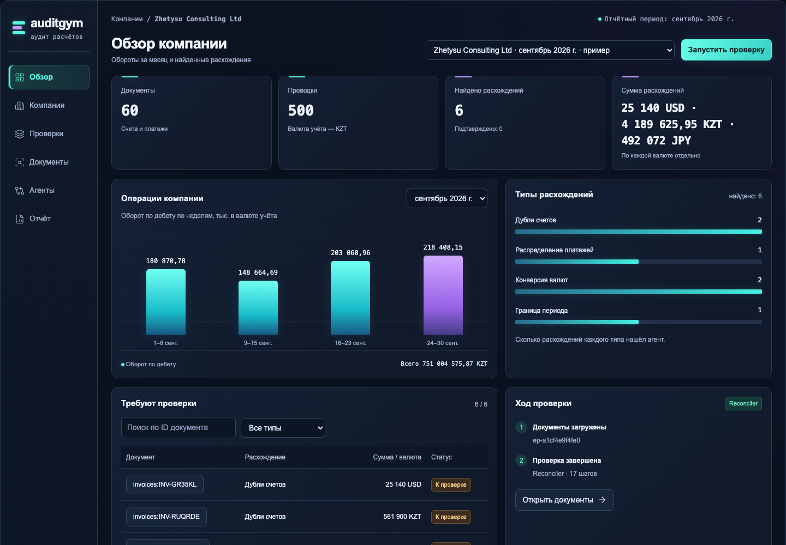

# audit-rl-env (`auditgym`)

Воспроизводимая RL-среда для ИИ-аудитора: синтетические документы компании, инструменты расследования,
скрытые финансовые ошибки и функция награды. FinTech-трек хакатона, 19–22 ноября 2026.

> Генератор, командные AuditEnv/Grader и разработки участника 4 интегрированы.
> ТЗ команды — [`docs/TZ.md`](docs/TZ.md).

## Быстрый старт

```bash
python -m pip install -e ".[dev]"
python -m auditgym.runner.validate --out runs/check --deadline 600
python -m auditgym.runner --episodes episodes/sample/sample_00 --out runs/sample
python -m auditgym.runner --mode eval --episodes episodes/sample/sample_00 --out runs/eval
python -m auditgym.runner.demo
```

Полный прогон включает линтер, все тесты участников, 320 приёмочных проверок,
SHA256, selfcheck grader и четыре политики на dev. Для каждого прогона runner
и validate используйте новую папку вывода. На Linux также доступны:

```bash
make install
make check          # единая команда проверки
make docker-check   # то же в контейнере: --network none --cpus 2 --memory 4g
```

## Политики и результаты

Runner использует среду участника 2 и оценщик участника 3 без альтернативной
реализации этих модулей. Политики читают `result.items[*].record`; метрики берутся
из `grade_log`. Диагностика grader с закрытыми ID не попадает в траектории агента.
Oracle получает эталон от runner; остальные политики получают только наблюдения.
В eval среда использует отдельный процесс, а награды в траектории равны нулю.

| Политика | Средний F1 на 21 опубликованном эпизоде | Максимум шагов |
| --- | ---: | ---: |
| Oracle | 1,0 | 1 |
| Reconciler | 1,0 | 45 |
| FlagAll | 0 | 2 |
| RandomExplorer (seed=42) | 0 | 9 |

Файлы runner: `trajectories.jsonl`, `results.csv`, `leak_report.json`. CSV содержит
версии среды/оценщика, P/R/F1, награду, возврат, шаги и время. `--dry-run` оставлен
для диагностики транспорта без финансовых оценок. Ограничения и приёмка — в
[`docs/acceptance.md`](docs/acceptance.md), упаковка — в [`docs/package.md`](docs/package.md).

Запись терминального демо на 135 секунд: `docs/demo/participant4.cast`
(`asciinema play docs/demo/participant4.cast`). Это результаты реального прогона
с паузами для чтения, а не имитация времени агента. Для новой записи:
`python -m auditgym.runner.demo --record runs/demo/demo.cast --duration 135`.

## Веб-обозреватель

Открыть через GitHub без локальной установки:
**[Запустить в GitHub Codespaces](https://codespaces.new/Goslinuly/audit-rl-env?quickstart=1)**.
Создайте codespace из `main`; конфигурация установит зависимости и запустит
интерфейс на порту 8000. Если вкладка не открылась, выберите **Ports → 8000 → Open in Browser**.
Нужны доступ к репозиторию и доступные ресурсы Codespaces в аккаунте GitHub.



Скачайте репозиторий через **Code → Download ZIP**, распакуйте и откройте терминал
в его папке. Требуется Python 3.11 или новее:

```bash
python -m pip install -e ".[dev]"
python ui/server.py
```

Откройте **http://localhost:8000**. Cyberpunk-интерфейс содержит страницы
«Обзор», «Компании», «Эпизоды», «Расследование», «Сравнение агентов» и «Отчёты».
Документы и генерация по всем пресетам/seed работают через API команды.
Запуск агента и сравнение используют настоящие AuditEnv, runner и grader.
Oracle помечен как привилегированный эталон. Отчёты скачиваются в TXT, CSV и JSON.

Названия компаний, состав рабочего каталога и ручные подтверждения сохраняются
в этом браузере. Удаление из каталога не удаляет опубликованные эпизоды команды.
Результаты и траектории прогонов хранятся в памяти до обновления страницы;
скачайте отчёт для сохранения результатов. Ручное подтверждение не меняет оценку grader.

GitHub показывает исходники, но не выполняет Python API: открывать `index.html`
двойным кликом вместо запуска сервера не нужно. `/prototype.html` открывает тот же
подключённый интерфейс. Старый обозреватель доступен по `/explorer.html`; его
«Режим проверяющего» показывает эталон для опубликованных открытых эпизодов.
Архив исходного демонстрационного дизайна — `ui/design/auditgym-prototype.html`.

HTTP-тесты входят в `make check`; отдельный job `web-ui` проверяет все страницы
в браузере. Локальный запуск браузерного набора описан в [docs/web-ui.md](docs/web-ui.md).
Опубликованная версия: https://explorer-production-573177ce.up.railway.app
(деплой вручную: `railway up --service explorer`).

## Структура

| Путь | Что там |
| --- | --- |
| `auditgym/generator/` | скрытая история компании, документы, инъекция ошибок, отвлекающие случаи |
| `auditgym/env/` | `AuditEnv.reset/step`, инструменты, калькулятор |
| `auditgym/grader/` | валидация findings, matcher, метрики, награда |
| `auditgym/policies/` | RandomExplorer, Reconciler, FlagAll, Oracle |
| `auditgym/runner/` | прогон эпизодов, `trajectories.jsonl`, отчёт |
| `schemas/` | JSON Schema всех форматов |
| `configs/`, `episodes/` | train/dev конфиги и эпизоды |
| `tests/` | тесты модулей и приёмочный набор |

Все данные вымышлены. Это программная задача, а не аудиторское заключение.

Лицензия: MIT.
